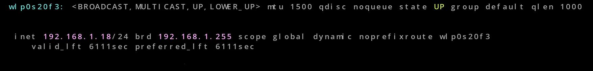
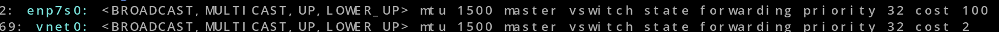
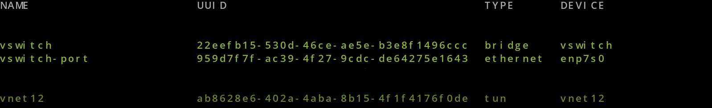
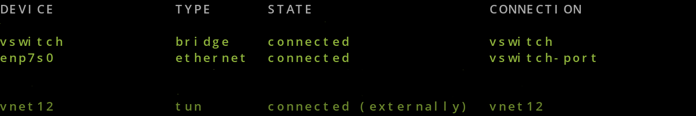

# Bridged Ubuntu VM on KVM: its own IP on the LAN, host connects to the network through Wi-Fi

## Goal

- Building a VM with separate network identity -so it appears as a device on the local network- to try new things I learn on,for example: like hosting http server and blocking traffic using iptables and try that from my host or ssh or to try VNC or NFS, etc....

## Notes before you start

- You have to be connected to the network through Wi-Fi because we will use the ethernet for the VM.

- A bridged VM sits on your real LAN, so don’t leave deliberately vulnerable services running on it.

## Environment

  **Host**:Fedora 44 , KVM/QEMU , libvirt , virtual-machine-manager(GUI app)

  **VM**:Ubuntu 24.04 

## Steps

1. Find your ethernet interface name use: `ip -br link` the ethernet interface is the one starting with letter (e).

2. Create the bridge device (virtual switch device).  `sudo nmcli con add type bridge ifname br0 con-name br0 ipv4.method disabled ipv6.method disabled` **Note**:

  * Actually the bridge can get an IP address for the host as NetworkManager treats it as normal interface for the host and just send DHCP request and get an IP that's why you see **ipv4.method disabled ipv6.method disabled** in the command,
and actually that's the normal way of doing that and the host and the VM both connects to the network via one ethernet cable,
but for our purpose is to make a separate route for the VM to connect to the network different from the host which is connected through Wi-Fi.

  

3. Enslave the physical ethernet NIC of your device so it becomes just a port on the bridge and that also will make NetworkManager not to ask for an IP using this interface. `sudo nmcli con add type ethernet slave-type bridge con-name br0-port ifname <ethernet-interface> master br0`

4. `nmcli con up br0-port` just to make sure that the active profile for the ethernet interface is the slave-type bridge you just made.

5. You should shutdown the VM if it's running. `sudo virsh shutdown <vm-name>`

6. `sudo virsh attach-interface <vm-name> bridge --source br0 --model virtio --config` to add the bridge interface for the VM and the `--source` flag is just specifying the bridge device for the VM to use.

7. `sudo virsh domiflist <vm-name>` which will list to you all the interfaces and their mac-addresses and type(network or bridge).

8. `sudo virsh detach-interface <vm-name> network --mac <mac-address> --config` **NOTE** > From the step 7 table you will get the mac-address(its the mac of the interface which its type is network NOT bridge).

9. Finally, open your VM from the GUI app and check by running `ip addr`.

And also you should have different IP on the host.

And you can also run this in host `bridge link show`.

## Undo 

If you want to undo all this just delete the ethernet NIC profile `sudo nmcli con delete br0-port`
And the bridge (br0) profile `sudo nmcli con delete br0` 

And also you will have to detach the NIC which its network source is (bridge) and create another NIC device with default network source (NAT):

* `sudo virsh detach-interface <vm-name> --type bridge --mac <mac-address> --config` ,
you will also get the mac-address from running `sudo virsh domiflist <vm-name>` 

* `sudo virsh attach-interface <vm-name> --type network  --source default --model virtio  --config`

## Explaining everything in details 

**vnet0** : is a tap device created by libvirt(the management layer, it creates and tracks the VMs) to connect it to the bridge, think of it like a logical ethernet cable that only exists in RAM.

**br0** : is the bridge device we created , it also live in RAM only that's why nmcli creates a profile for it to be able to create it again if you rebooted your host device , you can see that by running `nmcli con show` 
you will see in the name column (br0) and in the device column (br0) you can actually choose whatever name you want(I personally named it vswitch) , we just name the bridge device and its profile-name the same name for simplicity, you can actually see it listed with your other interfaces if you run `nmcli device status` 

**br0-port** : is the active profile connection for the host's ethernet NIC that makes it act like a port on the bridge so that NetworkManager doesn't ask for an IP (DHCP request) for the host using this interface when that profile is active.
You can also use your ethernet NIC again normally for your host by changing between active profile connections for the ethernet interface.
*when you need the interface to act normally just drop the active profile that makes the interface act like a port* `nmcli con down br0-port`
And *activate whatever connection you want* `nmcli con up <profile-name>`
**Note**:
   * A bridge with no ports shows an all-zero MAC. With ports it takes the lowest MAC among its ports.
     No ports (host ethernet profile switched away, and the VM off or running with network source:NAT): ip link show br0 shows 00:00:00:00:00:00.
    
--------------------------------------------------------------------------------------------- 
    
a. In order to make a VM able to have its own IP on the network , we have to somehow  physically connect it to an ethernet port on a real physical switch device (or your home router as it's a router and a switch in the same time).

b. But in this case the device we want to connect the physical switch device is a virtualized environment inside your host , so to solve this problem we have to create (virtual switch) inside the kernel so it acts as a bridge that connects virtual environment to a real physical device(switch or home router).

c. Then the VM connects its virtual NIC to that bridge using a tap device , then we 'enslave'-(making the ethernet NIC of the host just a port on the bridge we created)- the ethernet NIC of the host so that when we plug in ethernet cable into the host physical port and the other end plugged in the physical switch device.

d. When the VM boots, it sends a DHCP request as a broadcast. The bridge notes "this MAC is on the vnet0 port" (it learns from the source MAC) and sends the broadcast out of its other port, the ethernet port, to the router. The router’s reply is addressed to the VM's MAC. It arrives on the ethernet port, the bridge finds that MAC in its table, and forwards it to vnet0.
